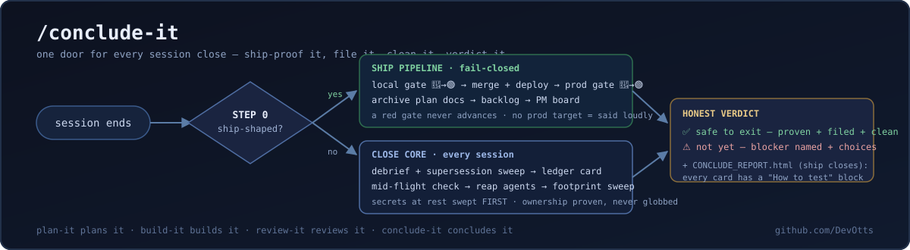

<div align="center">

<h1>/conclude-it</h1>

<h3>
  <strong>"Done" is a claim. Concluded is proven.</strong>
</h3>

<p>
  Your agent says the feature is done. Is it live? Verified in prod? Documented?<br>
  Is anything still running? Did it clean up after itself?<br>
  <strong>Stop closing sessions on hope — one command proves it, files it, cleans it, and tells you honestly if it's safe to walk away.</strong>
</p>

<a href="#how-it-works">
  
</a>

<p>
  <a href="#installation"></a>
  <a href="https://opensource.org/licenses/MIT"></a>
  <a href="https://claude.ai/code"></a>
  <a href="#platform-compatibility"></a>
  <a href="https://github.com/DevOtts"></a>
</p>

<p>
  <a href="#installation">Install</a>
  &nbsp;·&nbsp;
  <a href="#why-a-close-ritual">Why a close ritual</a>
  &nbsp;·&nbsp;
  <a href="#how-it-works">How it works</a>
  &nbsp;·&nbsp;
  <a href="#the-report">The report</a>
  &nbsp;·&nbsp;
  <a href="#whats-bundled">What's bundled</a>
  &nbsp;·&nbsp;
  <a href="#platform-compatibility">Platform compatibility</a>
  &nbsp;·&nbsp;
  <a href="CHANGELOG.md">Changelog</a>
</p>

> [!NOTE]
> **The lifecycle family** — plan-it plans it, build-it builds it, review-it reviews it, **conclude-it concludes it**: [`plan-it`](https://github.com/DevOtts/plan-it) plans → [`build-it`](https://github.com/DevOtts/build-it) builds → [`review-it`](https://github.com/DevOtts/review-it) verifies → **conclude-it** concludes. This is the last stage: the work is built and reviewed; conclude-it ships it, proves it in prod, files the knowledge, cleans the debris, and closes the session. ([`prompt-it`](https://github.com/DevOtts/prompt-it) compiles the prompts that start it all.)

<br>
</div>

Every long agent session ends the same way: you type the quit and hope. Hope the
knowledge that existed only in the conversation got written down somewhere. Hope
the feature you merged actually works in prod. Hope no background job is still
running, no worktree is left dangling, no credential got echoed into a file on a
remote host at 2am.

conclude-it replaces the hope with a ritual. **One command, every close.** A
mechanical triage looks at what the session actually did — deploys run, feature
work at the merge boundary, a Definition of Done met without prod verification —
and picks the leg for you:

- **Ship-shaped session** → the **ship pipeline** first: local test gate →
  merge + deploy → prod gate → archive the plan docs → capture the backlog →
  update the board. Fail-closed: a red gate never proceeds, and a skipped gate
  *is* a failed gate.
- **Plain session** (research, planning, Q&A — the common case) → straight to
  the **close core**.

Then every session, both legs, gets the same close core: debrief the knowledge
into durable docs, write the session-history ledger card, verify nothing is
mid-flight, reap idle subagents, sweep the session's own footprint (secrets at
rest first), and end with a verdict you can trust.

## Why a close ritual

Because the failure modes of *ending* a session are quieter than the failure
modes of running one — and they compound:

| Without a ritual | With conclude-it |
|---|---|
| "Done" means "the code is written" | Done means **green in prod**, or it's loudly labeled "deployed-but-unverified" |
| Session knowledge dies with the transcript | Debrief promotes it into durable docs — and a **supersession sweep** retires the docs the change replaced, so you never keep two "current" pages describing two versions of one feature |
| "Which session did X?" means re-reading transcripts | A ≤40-line ledger card per session answers it for ~150 tokens |
| Zombie subagents hold RAM; orphaned processes linger | Finished agents reaped; headless processes killed **by exact recorded PID only** |
| Worktrees, scratch files, and the occasional credential accumulate | The footprint sweep removes what the session can *prove* it created — secrets first, verified absent — and reports what it deliberately left |
| The summary shows the green half | The verdict and the HTML report show **every** state — RED and UNVERIFIED get their own badges |

The honest claim: conclude-it doesn't make your tests pass or your deploy work.
It makes it impossible to *close* a session on top of a failure without seeing
it named.

## Installation

conclude-it ships as both a **Claude Code plugin** and a standard repo-root
**`SKILL.md`**, so it installs across the whole agent ecosystem. Pick your tool
below.

> [!TIP]
> **Two universal installers** understand the `SKILL.md` standard and drop conclude-it into the right directory for 70+ tools — use these if your agent isn't listed:
> ```sh
> npx skills add DevOtts/conclude-it -a <agent>   # e.g. -a codex, -a cursor, -a github-copilot ; add -g for global
> gh skill install DevOtts/conclude-it            # GitHub CLI (project or user scope)
> ```
> Peek first with `npx skills add DevOtts/conclude-it --list`.

### Claude Code  ·  *native, full experience*

```sh
# 1. Register the marketplace
/plugin marketplace add DevOtts/conclude-it

# 2. Install the plugin (plugin-name@marketplace-name)
/plugin install conclude-it@devotts
```

The marketplace name `devotts` comes from the `name` field in
[marketplace.json](.claude-plugin/marketplace.json). This is the **only** target
that gets the full bundle — the conductor with its progressive-disclosure ship
pipeline, the deterministic `build-report.py` + HTML template machinery, *and*
the bundled generic `session-debrief`, with slash-command invocation and
auto-activation. (Skills-CLI alternative: `npx skills add DevOtts/conclude-it -a claude-code`.)

### Codex  ·  *OpenAI Codex CLI*

```sh
npx skills add DevOtts/conclude-it -a codex
# or:  gh skill install DevOtts/conclude-it
```

Installs to the shared `.agents/skills/conclude-it/` that Codex reads. Codex
doesn't carry the bundled machinery, so conclude-it runs the debrief **inline**
and writes the closeout report as markdown (graceful degradation) — you still
get the triage, the fail-closed gates, the ledger card, the sweeps, and the
honest verdict.

### OpenClaw

```sh
npx skills add DevOtts/conclude-it -a openclaw
```

Lands in `.openclaw/skills/conclude-it/SKILL.md`.

### Cursor

```sh
npx skills add DevOtts/conclude-it -a cursor      # add -g for a global install
```

Installs into Cursor's `.agents/skills/` and is auto-discovered.

### VS Code + GitHub Copilot

```sh
npx skills add DevOtts/conclude-it -a github-copilot
# or:  gh skill install DevOtts/conclude-it
```

Copilot auto-discovers skills under `.agents/skills/`.

### Copilot CLI

```sh
gh skill install DevOtts/conclude-it
# or:  npx skills add DevOtts/conclude-it -a github-copilot
```

### Kiro CLI / IDE

```sh
gh skill install DevOtts/conclude-it
```

If your Kiro build doesn't yet read the shared skills path, drop the skill in manually:

```sh
git clone https://github.com/DevOtts/conclude-it /tmp/conclude-it
mkdir -p "<kiro-skills-dir>/conclude-it" && cp /tmp/conclude-it/SKILL.md "<kiro-skills-dir>/conclude-it/"
```

### Others  ·  *OpenCode · Cline · Windsurf · Zed · Gemini CLI · Antigravity · Amp · Warp …*

```sh
npx skills add DevOtts/conclude-it -a <agent>
```

Run `npx skills add DevOtts/conclude-it --list`, then target your agent — the
CLI knows the correct path for each. **Manual fallback for any tool:** clone the
repo and copy the root [`SKILL.md`](SKILL.md) into your agent's
skills/instructions directory.

> [!NOTE]
> On every target **except Claude Code**, conclude-it installs as a single self-contained skill (the root `SKILL.md` — it carries the full flow, ship pipeline included). The HTML report machinery, the bundled `session-debrief`, and delegated helpers like `/iterate` and `/full-qa` are Claude Code plugin pieces; elsewhere conclude-it runs those phases inline, writes the closeout report as markdown, and **names the absence in its verdict** instead of pretending. The thing that ports everywhere is the **ritual** — the gates, the sweeps, and the honesty.

### Use

```
/conclude-it        # at the end of any session — the triage picks the leg
```

Also answers to plain language: *"close this session"*, *"wrap up and exit"*,
*"ship it and close"*, *"I'm done for now"*, *"is it safe to exit?"*.

## First run — conclude-it interviews your repo (once)

The first time you close a session in a repo, conclude-it runs a **five-question
setup interview** — and it detects before it asks, so most questions arrive
pre-answered for you to confirm:

1. **Where is your documentation folder?**
2. **Do you keep a second brain** (Obsidian or similar)? Path?
3. **Is it global or per-project?** Explain the layout — or just say the word
   and it inspects the vault and *proposes* where session knowledge should be
   filed (a guess is always labeled as a guess, never silently trusted).
4. **Deploy** — it recommends you create (or point it to) a `<project>-deploy`
   skill with this repo's exact deploy instructions, and offers to scaffold it
   from what it already knows. Until then, deploys run inline via your
   documented path.
5. **Debrief** — same shape: a `<project>-debrief` skill describing how your
   docs structure works; otherwise the bundled generic `session-debrief`.

The answers are saved as a small block **inside the repo** (`CLAUDE.md` /
`AGENTS.md` / `.conclude-it/config.md`) — per-repo memory, committable,
reviewable. Open a different repo and it asks again *there*; it never writes
your answers globally unless you explicitly say "save this globally". Every
later close reads the block silently and gets straight to work.

## How it works

```
                         ┌──────────────────────┐
        /conclude-it ──▶ │  STEP 0 · TRIAGE      │  mechanical signals, not vibes:
                         │  ship-shaped?         │  deploys run? merges pending? DoD
                         └──────┬───────┬────────┘  met without prod verification?
                          yes   │       │   no
              ┌─────────────────▼─┐     │
              │  SHIP PIPELINE    │     │
              │  S1 local gate 🔴🟢│     │   fail-closed: red never advances;
              │  S2 merge+deploy  │     │   fix loops until green;
              │  S3 prod gate 🔴🟢 │     │   no prod target → "deployed-but-
              │  S4 archive docs  │     │   unverified", said loudly
              │  S5 backlog       │     │
              │  S6 PM board      │     │
              └─────────────────┬─┘     │
                                ▼       ▼
              ┌──────────────────────────────────┐
              │  CLOSE CORE (every session)      │
              │  1  debrief + supersession sweep │
              │  2  session-history ledger card  │
              │  3  mid-flight verification      │
              │  4  reap subagents + processes   │
              │  5  footprint sweep (secrets 1st)│
              │  6  CONCLUDE_REPORT.html (ship)  │
              └────────────────┬─────────────────┘
                               ▼
               ✅ safe to exit  /  ⚠️ not yet — here's the blocker
```

Three details that took real sessions to learn, baked in:

- **The debrief guard is durable, not memory.** In long, compacted sessions,
  "did the debrief already run?" is answered by checking artifacts on disk —
  never by trusting the model's recall.
- **Orchestrators close their orchestra.** A session that dispatched other
  sessions (peers, headless spawns, cloud runs) verifies each one reached a
  terminal state before it may close itself. No worker left running unowned.
- **Ownership is proven, never globbed.** The sweep deletes by exact name after
  checking dates and attribution. `rm /tmp/q*.js` once nearly took out another
  session's six-week-old file; listing first is the rule.

## The report

Ship-shaped closes end with `CONCLUDE_REPORT.html` — a **local** HTML report
(never a hosted page) rendered deterministically by the bundled
`build-report.py` from a small JSON manifest. Light/dark toggle, a gates
scoreboard, one badge card per item (`ok` / `hold` / `open` / `act`), the
referenced markdown reports embedded as collapsed toggles — and on every card a
**"How to test"** block: real steps *you* can perform to verify the claim, not a
restatement of what the agent ran. RED and UNVERIFIED items get their own badges
with the blocker named. A report that only shows the green half is a fake.

(Outside Claude Code, where the machinery isn't installed, the same report is
written as markdown with the same honest structure.)

## What's bundled

| Piece | What it is |
|---|---|
| `skills/conclude-it/SKILL.md` | The close core + Step-0 triage (always loaded) |
| `skills/conclude-it/references/ship-pipeline.md` | The ship leg S0–S7 (loaded only when triage says ship-shaped — plain closes never pay for it) |
| `skills/conclude-it/build-report.py` + `report-template.html` | Deterministic report machinery — agents author a JSON manifest, never hand-written HTML |
| `skills/session-debrief/SKILL.md` | Generic end-of-session knowledge capture with the anti-rot promotion rule and the supersession sweep — used when the project has no debrief skill of its own |

conclude-it conducts, it doesn't reimplement: if your project has its own deploy
skill, test scripts, debrief, or PM board, those are what run. Pairs naturally
with [`build-it`](https://github.com/DevOtts/build-it)'s `/iterate` and
`/full-qa` for the red-gate fix loops, but degrades gracefully without them.

## Security considerations

- **Secrets-at-rest sweep** — credentials the session wrote (local, remote host,
  or inside a pod) are hunted first, removed, and **verified absent**.
- **Exact-PID kills** — never pattern-matched; a grep-kill can take out another
  session's process.
- **Proven ownership** — only artifacts the session can show it created are
  deleted; everything else is reported, never touched.
- **Scoped deploy authorization** — the ship path authorizes the deploy
  sequence; irreversible destructive actions always require an explicit yes.
- **Local-only reporting** — the closeout report is a file on disk; nothing is
  published to hosted surfaces uninvited.

## Platform compatibility

conclude-it is a `SKILL.md` at its core, so it runs anywhere the open
[Agent Skills](https://github.com/vercel-labs/skills) standard does. **Claude
Code** gets the full plugin (conductor + report machinery + bundled
`session-debrief`); every other tool gets the portable **ritual** — triage,
fail-closed gates, ledger card, sweeps, and the honest verdict — with the
delegated pieces running inline.

Every `skills add -a <agent>` row below is shorthand for
`npx skills add DevOtts/conclude-it -a <agent>` (append `-g` for a global
install). Don't see your tool? Run `npx skills add DevOtts/conclude-it --list` —
the CLI supports 70+ agents.

| Platform | Status | Install Method |
|----------|--------|----------------|
| Claude Code | ✅ Native | Plugin marketplace |
| Cursor | ✅ Supported | Auto-discovery |
| VS Code + GitHub Copilot | ✅ Supported | Auto-discovery |
| Copilot CLI | ✅ Supported | `gh skill install` |
| Codex | ✅ Supported | `skills add -a codex` |
| OpenCode | ✅ Supported | `skills add -a opencode` |
| OpenClaw | ✅ Supported | `skills add -a openclaw` |
| Antigravity | ✅ Supported | `skills add -a antigravity` |
| Gemini CLI | ✅ Supported | `skills add -a gemini-cli` |
| Pi Agent | ✅ Supported | `skills add -a pi` |
| Vibe CLI | ✅ Supported | `skills add -a mistral-vibe` |
| Hermes | ✅ Supported | `skills add -a hermes-agent` |
| Cline | ✅ Supported | `skills add -a cline` |
| KIMI CLI | ✅ Supported | `skills add -a kimi-code-cli` |
| Trae | ✅ Supported | `skills add -a trae` |
| Nanobot | ✅ Supported | Manual — copy `SKILL.md` |
| Kiro CLI / IDE | ✅ Supported | `skills add -a kiro-cli` |
| Windsurf · Zed · Amp · Warp · Roo · Goose · Junie · Qwen · …50+ more | ✅ Supported | `npx skills add DevOtts/conclude-it --list` |

**Legend** — **✅ Native:** the complete plugin (conductor + progressive-disclosure ship pipeline + HTML report machinery + bundled `session-debrief`, slash-command + auto-activation). **✅ Supported:** the self-contained root `SKILL.md` installs and runs the full ritual; Claude-specific pieces (HTML machinery, bundled debrief, delegated `/iterate`//`/full-qa`) execute inline, and the verdict names what ran inline.

## License

MIT — see [LICENSE](LICENSE) and [plugin.json](plugins/conclude-it/.claude-plugin/plugin.json). Use it, fork it, close with it.

---
<div align="center">
<em>Authored by <a href="https://github.com/DevOtts">DevOtts</a> · part of the <strong>*-it</strong> lifecycle family:
<a href="https://github.com/DevOtts/prompt-it">prompt-it</a> ·
<a href="https://github.com/DevOtts/plan-it">plan-it</a> ·
<a href="https://github.com/DevOtts/build-it">build-it</a> ·
<a href="https://github.com/DevOtts/review-it">review-it</a> ·
<strong>conclude-it</strong></em>
</div>
